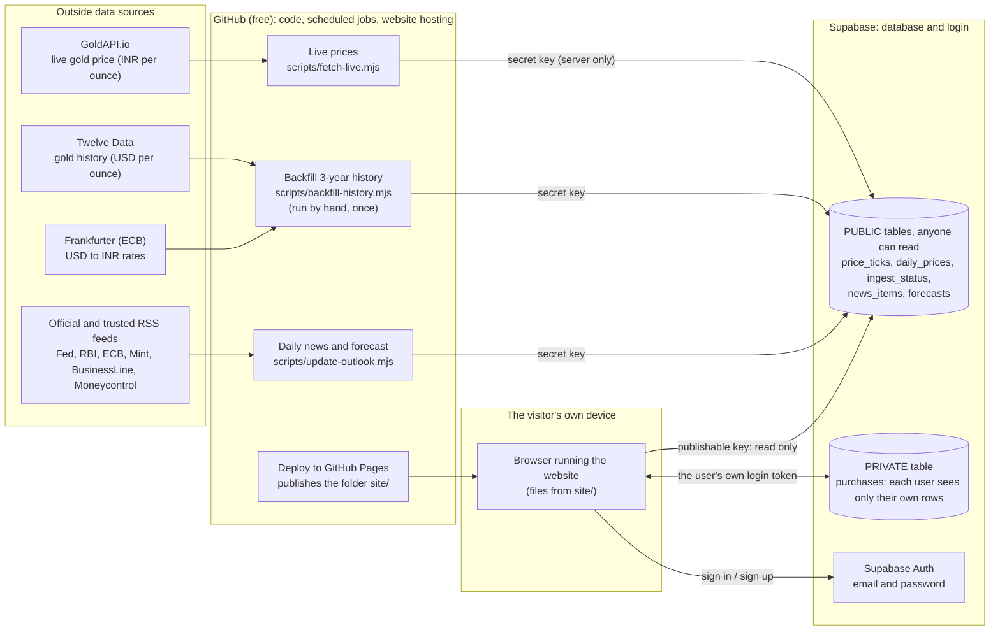
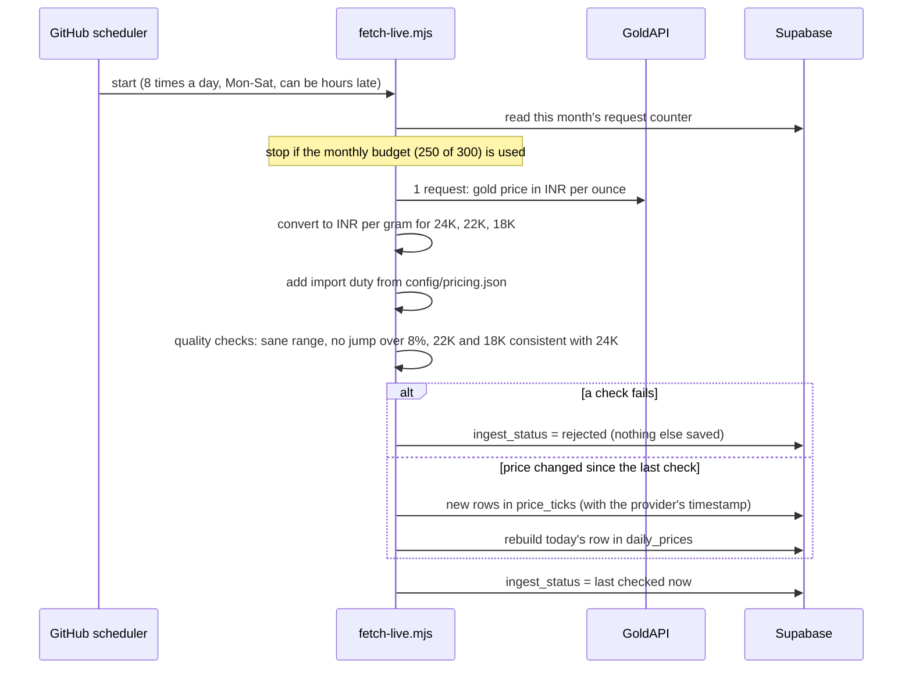
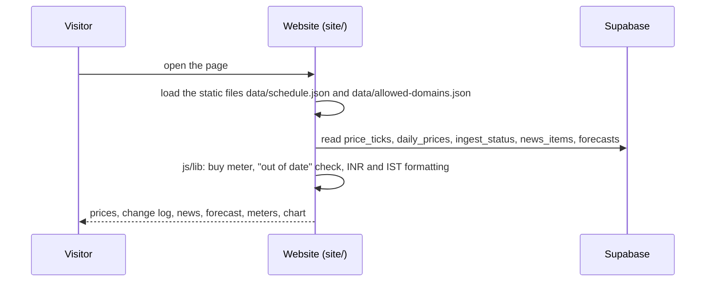
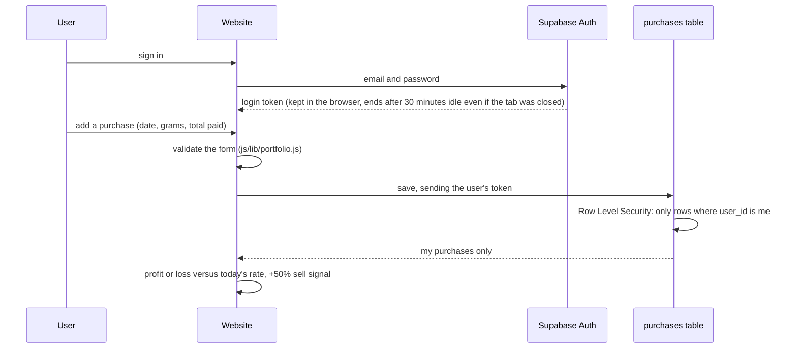

# Architecture guide

**Read this first if you are new to the project.** It explains how Gold Tracker India works, where every piece of data comes from, what each folder is for, and how to change things safely. No special background needed.

Related files: `README.md` (setup), `CLAUDE.md` (rules for developers and for Claude Code), `SECURITY.md` (security model), `docs/PROGRESS.md` (running log of decisions and what is left).

---

## 1. What the app does (in one minute)

- Shows **today's gold rate in India** (24K, 22K, 18K) per gram and per 10 g, every price change of the day, 3 years of history, news headlines, a 3-day forecast range and a "good time to buy?" meter.
- Lets a signed-in user **record gold purchases** (date, grams, total paid including GST) and see profit or loss and a "sell target reached" signal at +50%.
- Everything shown is an **honestly labelled estimate**: international price converted to INR plus import duty. It is not your jeweller's rate.

There is **no server of our own**. The website is static files. Scheduled GitHub jobs collect the data and save it in a Supabase database. The website reads the database directly from the browser.

```
 Outside data ──► GitHub scheduled jobs ──► Supabase database ──► Website in the visitor's browser
 (prices, FX,        (collect, check,         (public tables +       (GitHub Pages serves
  news feeds)         then save)               one private table)     the folder site/)
```

---

## 2. The big picture



**Key idea:** only the three scheduled jobs can *write* prices, news and forecasts (they hold the secret key, stored in GitHub secrets). The browser can only *read* them. The browser can read and write the `purchases` table, but only its own rows, enforced by the database itself (Row Level Security).

---

## 3. How the data flows

### 3a. Live price update (the heartbeat)



- A row is added to `price_ticks` **only when the price differs** from the last one. That table is the "Today's price changes" log. The time shown is when a check *noticed* the change.
- Bad data is **rejected, not shown**. If nothing is saved, the site keeps the last good price and warns when it gets old.

### 3b. History (one-off)

`Backfill 3-year history` (manual workflow) = Twelve Data gold price in USD x official USD/INR from the ECB (via Frankfurter) x import duty, per trading day, saved into `daily_prices` with `is_estimate = true`. It saves nothing unless the data covers about 3 years and is plausible. If the source is unavailable, `scripts/import-csv.mjs` loads your own CSV.

### 3c. News and forecast (every morning, 06:00 IST)

`scripts/update-outlook.mjs` does two separate things:

1. **News:** reads the feeds listed in `config/feeds.json`, keeps gold-related headlines from the last 24 hours (simple keyword scoring in `scripts/lib/feeds.mjs`), checks them (secure https link on the trusted list, cleaned text), and saves them to `news_items`. Impact is always "unclear". **No AI by default.**
2. **Forecast:** computes a 3-day range from how much the price has really been moving (`forecastRange` in `site/js/lib/analytics.js`), and saves it to `forecasts`. News does **not** change it.

Optional paid mode: repository variable `NEWS_MODE=claude` makes Claude write the news summaries (needs API credits). It is off by default.

### 3d. A visitor opens the website



If the database cannot be reached, the page shows an honest error and **no numbers** (it never guesses).

### 3e. A signed-in user tracks their gold (private)



Purchases are **never** stored in the browser (only the login token is), and never logged. Signing out (or 30 minutes of inactivity, also checked when the site is reopened) clears the token **and** revokes the session on the server.

---

## 4. Folder map: what lives where

| Folder / file | What it is | Touch it when you want to... |
|---|---|---|
| `site/` | **The website.** Plain HTML, CSS and JavaScript, no build step. GitHub Pages publishes this folder as-is. | change what visitors see |
| `site/index.html` | Page shell, security policy (CSP), nav | add a nav item, change page title |
| `site/css/style.css` | All styling (light and dark theme) | change colours or layout |
| `site/js/app.js` | Starts the app, router (which page for which `#/route`), theme | add a page |
| `site/js/views/` | One file per page: `today.js`, `charts.js`, `mygold.js`, `about.js` | change a page's content |
| `site/js/api.js` | **All database reads and writes** from the browser (Supabase REST) | add a new data query |
| `site/js/auth.js` | Sign-up, sign-in, token refresh, idle sign-out, friendly error texts | change login behaviour |
| `site/js/config.js` | Supabase URL + **publishable** key (public by design) | point the site at another Supabase project |
| `site/js/lib/` | **Pure logic** (no network, no page): `pricing.js` (unit conversion, data-quality rules, "out of date" check), `analytics.js` (forecast range, buy meter, sell meter), `portfolio.js` (profit/loss, purchase validation), `format.js` (₹ and IST) | change a formula or a rule. **Start here for most logic changes.** |
| `site/js/safe.js`, `ui.js`, `chart.js` | Safe DOM helpers (no `innerHTML`), shared widgets, SVG chart | change look of widgets |
| `site/data/schedule.json` | **Which metals and which times** the live job runs; also drives the "next update" text and the "out of date" rule | change update times, switch silver on |
| `site/data/allowed-domains.json` | **Trusted domains** (news, data providers) and a blocklist. Read by the jobs, the browser and the Claude Code hooks | add a trusted source (needs the owner's approval) |
| `scripts/` | **The jobs** that run on GitHub (Node.js): `fetch-live.mjs`, `backfill-history.mjs`, `import-csv.mjs`, `update-outlook.mjs`, `validate-content.mjs`, `serve.mjs` (local preview) | change how data is collected |
| `scripts/lib/` | Job helpers: `db.mjs` (database writes), `feeds.mjs` (RSS and calendar reading), `history.mjs` (history building), `outlook.mjs` (news validation), `quota.mjs` (monthly request counter), `common.mjs` (allowlist, safe fetch, config loading) | change a helper |
| `config/pricing.json` | **Import duty %** and premium used to turn the international price into an estimated Indian rate; history length | update duty after a government change |
| `config/feeds.json` | **News feed list** | add or remove a feed |
| `supabase/schema.sql` | The whole database: tables, constraints, Row Level Security. Safe to re-run | change the database |
| `.github/workflows/` | When jobs run and with which secrets (see section 6) | change a schedule or add a job |
| `tests/` | `*.test.mjs` = unit tests (fast). `e2e/` = real-browser tests against a fake in-memory database | always add or update a test with a change |
| `.claude/` | Guard rails for Claude Code (blocks untrusted sites, secrets in code). Not part of the running app | rarely |
| `docs/` | This guide and the running project log | keep up to date |
| `CLAUDE.md`, `SECURITY.md`, `README.md` | Rules, security model, setup | read before changing anything important |

---

## 5. The database (Supabase)

| Table | Holds | Written by | Read by | Public? |
|---|---|---|---|---|
| `price_ticks` | One row each time a check saw a **different** price (metal, purity, price per gram, raw price, duty applied, source, provider time) | Live prices job | Today page, change log | yes (read only) |
| `daily_prices` | One row per day per purity: open, high, low, close. History rows are estimates (`is_estimate`) | Backfill job, Live prices job (today's row) | Charts, previous close, buy meter, forecast | yes (read only) |
| `ingest_status` | Heartbeat: when each source was last checked, success or not. (A second internal row counts GoldAPI requests; the public read policy hides it) | Live prices job | "last checked" and "out of date" logic | yes (read only) |
| `news_items` | Headlines and scheduled events for a day | Daily news job | Market watch box | yes (read only) |
| `forecasts` | 3-day low / middle / high per purity | Daily news job | Forecast table | yes (read only) |
| `purchases` | A user's purchases (date, metal, purity, grams, total paid, GST, charges) | The signed-in user (website) | The same user only | **no, private** |

Security in one sentence: the public tables have **no insert/update/delete rights for the browser**, and `purchases` has Row Level Security so a user can only ever touch rows where `user_id` equals their own id. The `anon` role has no access to `purchases` at all.

---

## 6. Schedules, secrets and config

**Workflows** (`.github/workflows/`)

| Workflow | When | What it runs |
|---|---|---|
| `live-prices.yml` | 8 times a day, Mon to Sat (09:30 to 20:00 IST, every 90 minutes). Cron is in UTC | `scripts/fetch-live.mjs` |
| `daily-outlook.yml` | Every day 06:00 IST | `scripts/update-outlook.mjs` |
| `backfill-history.yml` | Manual button only | `scripts/backfill-history.mjs` |
| `deploy.yml` | On every merge to `main` (and manual) | validates, tests, publishes `site/` |
| `ci.yml` | On every pull request | unit tests + real-browser tests |

Important facts:
- **Workflows and schedules only work from the repository's default branch, which must be `main`.**
- The cron lines in `live-prices.yml` and `site/data/schedule.json` **must match** (a test fails if they drift). They are sized for GoldAPI's 300 requests/month: 8 runs x 1 request x 26 days = 208.
- GitHub's free scheduler can run jobs **hours late** or skip one. The site warns visitors only if a slot older than 6 hours was never covered.

**Secrets** (GitHub: Settings, Secrets and variables, Actions). Never put these in code.

| Name | Used by | Purpose |
|---|---|---|
| `SUPABASE_URL` | all jobs | database address |
| `SUPABASE_SERVICE_KEY` | all jobs | Supabase **secret** key: lets jobs write. Never in `site/` |
| `GOLDAPI_KEY` | Live prices | live price provider |
| `TWELVEDATA_API_KEY` | Backfill | history provider |
| `ANTHROPIC_API_KEY` | Daily news, only if `NEWS_MODE=claude` | optional, paid |

Only two values are public and live in `site/js/config.js`: the Supabase URL and the **publishable** key.

---

## 7. Rules that must not be broken

(Full list in `CLAUDE.md`.)

1. Never show a number without its source and time. Never invent data. If data is missing, old or rejected, say so.
2. Label estimates as estimates (rates, history, forecast). It is not financial advice.
3. Private data stays private: never loosen Row Level Security, never store purchases in the browser.
4. Only trusted https domains (`site/data/allowed-domains.json`). Feed and web text is untrusted: clean it, never render it as HTML.
5. No `innerHTML`, `eval` or inline scripts. Build the page with `h()` from `site/js/safe.js` (strict security policy).
6. Secrets only in GitHub secrets, never in the repo.
7. No ads, no trackers, no third-party scripts.
8. Keep the security tests green (`tests/security.test.mjs`): they fail if someone adds an HTML-injection sink, loosens the page policy, weakens a database rule, adds secrets, or gives a workflow more access than it needs. Details and owner to-dos: `SECURITY.md`.

---

## 8. "How do I...?" recipes

| I want to... | Do this | Then |
|---|---|---|
| Change **how often** prices update | Edit the cron lines in `live-prices.yml` **and** `times` in `site/data/schedule.json` together. Keep runs x metals x 26 under about 250 | `npm test` (the drift test checks both) |
| Update the **import duty** | Edit `config/pricing.json` | Next live run uses it. Old history rows keep the old duty unless you re-run Backfill |
| Switch **silver** on | `metals: ["gold","silver"]` in `site/data/schedule.json`, halve the run times, load silver history (`scripts/import-csv.mjs` with `inr-gram`; Twelve Data silver needs a paid plan) | `npm run test:e2e` has a silver test |
| Add or remove a **news feed** | Edit `config/feeds.json`. The host must be in `site/data/allowed-domains.json` | Run "Daily news and forecast"; the log shows `feed ok` or `feed failed` per feed |
| Change the **forecast** formula | `forecastRange` in `site/js/lib/analytics.js` | update `tests/analytics.test.mjs` |
| Change the **buy meter** or sell target | `buyMeter` and `SELL_TARGET_PCT` in `site/js/lib/analytics.js` | update `tests/analytics.test.mjs` |
| Change data-quality rules (jump limit, sane ranges) | `site/js/lib/pricing.js` (`validateTicks`, `SANE`) | update `tests/pricing.test.mjs` |
| Add a **page** | New file in `site/js/views/`, add a route in `site/js/app.js`, a link in `site/index.html` | add a test in `tests/e2e/site.test.mjs` |
| Add a **column or table** | Edit `supabase/schema.sql` (keep Row Level Security), run it in the Supabase SQL Editor (select all text first), then update `site/js/api.js` | add tests |
| Load **history from your own file** | CSV with columns `Date,Open,High,Low,Close`, then `node scripts/import-csv.mjs file.csv gold inr-gram-24k` (values already in INR per gram of 24K). For USD-per-ounce data use `usd-oz` and also set `FX_CSV` to a USD/INR CSV. The header of the script explains both | check the Price history page |
| **Rotate a key** | Create a new key at the provider, replace the GitHub secret, delete the old key | run the matching workflow once |
| Run the site **locally** | `npm install`, then `npm run serve`, open http://localhost:8080 | needs real values in `site/js/config.js` |

Before you push any change: `npm test` (unit) and `npm run test:e2e` (browser; needs `npx playwright install chromium` once). CI runs both on every pull request.

---

## 9. Troubleshooting: symptom, likely cause, where to look

| Symptom | Likely cause | Look at |
|---|---|---|
| "No prices yet" | Live prices job has never succeeded | Actions, Live prices, latest run log |
| "Prices may be out of date" | No successful check covering a slot older than 6 hours | Live prices runs: red? skipped? GoldAPI quota used? |
| A workflow is missing from the Actions list | Default branch is not `main`, or the file is not on `main` yet | Settings, General, Default branch |
| Live prices green but nothing changes | Price genuinely unchanged, or the monthly request budget (250) was reached | job log lines `request budget` and `::warning::` |
| Live prices red: "rejected by validation" | Price jumped over 8%, or looked impossible: a data-quality rule fired. Nothing was saved, by design | log line lists the problems |
| Backfill red | Source blocked, wrong plan, or less than 3 years of data. Nothing is written | log shows the provider's own message (key hidden) |
| Daily news green but "feed failed: HTTP 403" | That publisher blocks automated readers | replace the feed in `config/feeds.json` |
| Charts empty | Backfill not run | Actions, Backfill 3-year history |
| "Create account" shows an error | Supabase email limits, "Confirm email" waiting, or sign-ups off | the message under the buttons (plain language) |
| Deploy fails with "not allowed to deploy to github-pages" | Environment branch rule | Settings, Environments, github-pages |
| Prices look 5 to 7% different from the jeweller | Expected: estimate (international price plus duty); GST and making charges are not included | tune `local_premium_pct` in `config/pricing.json` |

---

## 10. Known limitations and open decisions

- **Rates are estimates**, not the jeweller's or an official Indian benchmark. A second provider to cross-check prices is a good future step.
- **Update times are approximate.** Checks are 90 minutes apart on a free scheduler that may run late. The change log shows when a check *noticed* a change. For exact timing use an external timer that triggers the workflow.
- **Gold only for now.** Silver code exists but is off (needs history data).
- **History source terms.** The free Twelve Data plan is labelled "internal non-display usage". Check their terms before showing the chart publicly.
- **News has no impact judgement.** Headlines are shown as "unclear impact". US release dates are not automatic (their publishers block bots); the page links the official calendars.
- **Import duty (6%)** is a setting that must be checked against current government rules.
